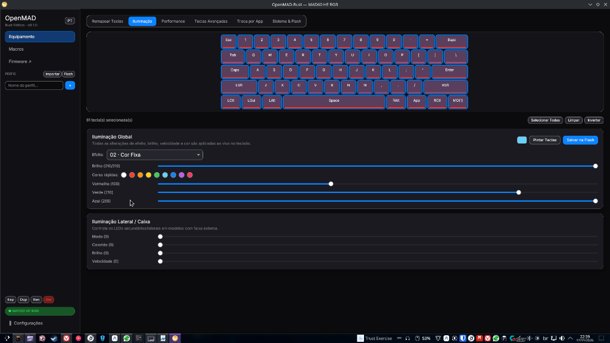
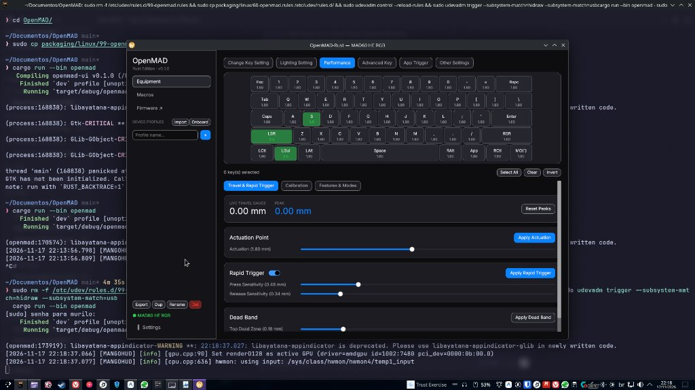
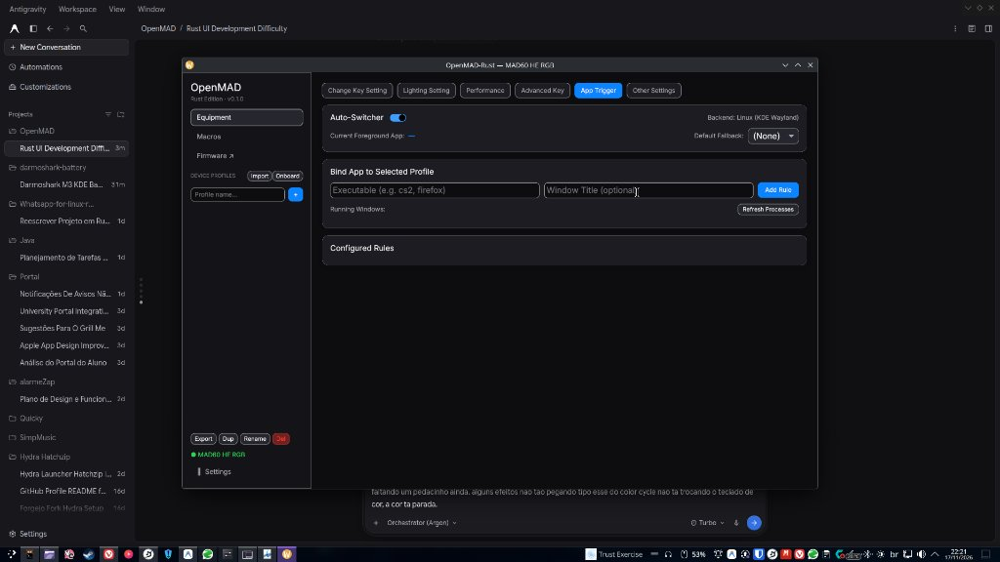

<div align="center">


# OpenMAD-Rust

**100% Native Rust driver, live telemetry utility, and real-time configurator for MAD68 HE / MAD60 HE Hall-effect magnetic keyboards.**

[-0A84FF?style=for-the-badge)](README.md)
[](README.en.md)

[](LICENSE)
[](Cargo.toml)
[](https://github.com/muriloscolari/OpenMAD-Rust/releases)

</div>

---

**OpenMAD-Rust** completely replaces the official Madlions web configurator and the earlier Python/web prototype with a **100% native Rust application** (`openmad-core` + `iced`-based `openmad-ui`). It boots instantly, uses minimal system resources, requires zero Electron/Chromium or Python runtime overhead, and supports **Linux (KDE Plasma Wayland, X11)** and **Windows** out of the box.

> [!NOTE]
> This project is a fork and full Rust rewrite inspired by the USB HID protocol reverse-engineering documented in [acciaw/OpenMAD](https://github.com/acciaw/OpenMAD).

---

## Screenshots

### Real-Time RGB Lighting & 2D Color Picker


### Performance, Key Travel Telemetry (0.10–3.50 mm) & Rapid Trigger


### Per-App Profile Auto-Switching (KDE Wayland / Windows)


---

## Architecture & How It Works

The workspace is structured into two Cargo crates:

1. **`openmad-core` (Driver, HID Protocol & Daemons)**
   - **Raw USB HID (`hidapi`)**: Connects directly to the keyboard's VIA/vendor HID interface (`VID 0x373B`, `usage_page 0xFF60`) without needing browser WebHID permissions.
   - **RAM Preview vs. Flash Writes**: Lighting, actuation point, deadband, and Rapid Trigger tweaks stream live to RAM (`FlashOp::Normal`) so you see instant results without wearing out onboard flash. Permanent flash commits happen only when explicitly saving to onboard memory.
   - **Live Telemetry Sampler (`sampler.rs`)**: Polls Hall-effect sensor travel continuously (calibrated up to **3.50 mm**) and feeds live readings + peak values to the UI gauge.
   - **Cross-Platform App Switcher (`switcher.rs`)**:
     - **Linux / KDE Plasma Wayland**: Automatically loads a lightweight **KWin Scripting** D-Bus bridge (`openmad_kwin_bridge`) to read the focused window class/caption in real time on native Wayland.
     - **Windows**: Polls foreground executable and window title natively via Win32 APIs (`GetForegroundWindow`).
   - **Self-Updater (`updater.rs`)**: Queries GitHub Releases (`muriloscolari/OpenMAD-Rust`), downloads the latest installer or binary asset, and applies the upgrade cleanly.
   - **Autostart (`settings.rs`)**: Registers OS sign-in launch with `--minimized` (`~/.config/autostart/openmad.desktop` on Linux; `HKCU\...\Run` on Windows).

2. **`openmad-ui` (GPU-Accelerated GUI & System Tray)**
   - Built with **`iced 0.13` (`iced::daemon`)** and the bundled `Inter` font.
   - **Instant Bilingual UI (`PT` / `EN`)** switchable from the sidebar header.
   - **2D HSV Color Picker Canvas + Quick Swatches** updating hardware LEDs immediately on click or drag.
   - **Native System Tray (`tray-icon`)**: Closing the window via `X` or launching with `--minimized` keeps OpenMAD-Rust running quietly in the system tray with right-click controls to show the window, switch saved profiles on the fly, or exit.

---

## Supported Keyboards

| Model | Vendor ID | Product ID | Status |
| :--- | :---: | :---: | :--- |
| **MAD60 HE RGB** | `0x373B` | `0x1054` | Verified on real hardware (HID, RGB, travel, RT, KWin Wayland) |
| **MAD68 HE RGB** | `0x373B` | `0x1058` | Supported via upstream protocol table |
| **MAD60 HE** | `0x373B` | `0x1053` | Supported via upstream protocol table |

> [!IMPORTANT]
> **Flash & Keymap Safety**: Do not unplug your keyboard while committing settings to onboard flash. OpenMAD-Rust includes explicit flash-write controls plus flash readback/JSON backup support.

---

## Installation Guide

Download the package for your OS from **[GitHub Releases](https://github.com/muriloscolari/OpenMAD-Rust/releases)**:

### 1. Windows (`.exe` Setup Installer)

1. Download **`OpenMAD-Setup-<version>.exe`** from [Releases](https://github.com/muriloscolari/OpenMAD-Rust/releases).
2. Run the installer (user-level install; does not require administrator privileges).
3. Check **"Start automatically minimized to system tray on sign-in"** in the wizard if desired (you can also toggle this anytime inside **Settings**).
4. **Auto-Updates**: Whenever a newer release is published on GitHub, **Settings** highlights **Install Update**, which downloads the latest Setup executable and performs a silent upgrade automatically.

---

### 2. Arch Linux / CachyOS / Manjaro

> [!TIP]
> [`packaging/arch/PKGBUILD`](packaging/arch/PKGBUILD) is already structured for future **AUR** submission.

#### Option A — Prebuilt Package (`.pkg.tar.zst`)
1. Download **`openmad-rust-<version>-1-x86_64.pkg.tar.zst`** from [Releases](https://github.com/muriloscolari/OpenMAD-Rust/releases).
2. Install using `pacman`:
   ```bash
   sudo pacman -U openmad-rust-*.pkg.tar.zst
   ```
3. Reload `udev` rules for rootless HID access (or unplug and replug the keyboard):
   ```bash
   sudo udevadm control --reload-rules
   sudo udevadm trigger --subsystem-match=hidraw --subsystem-match=usb
   ```

#### Option B — Build & Install Locally from Repo
```bash
git clone https://github.com/muriloscolari/OpenMAD-Rust.git
cd OpenMAD-Rust
./packaging/arch/install-arch.sh
sudo pacman -U dist/openmad-rust-*.pkg.tar.zst
sudo udevadm control --reload-rules && sudo udevadm trigger --subsystem-match=hidraw --subsystem-match=usb
```

---

### 3. Debian / Ubuntu / Linux Mint / Pop!_OS (`.deb`)

1. Download **`openmad_<version>_amd64.deb`** from [Releases](https://github.com/muriloscolari/OpenMAD-Rust/releases).
2. Install with `apt` (pulls runtime dependencies `libhidapi-hidraw0`, `libgtk-3-0`, `libayatana-appindicator3-1`, `libdbus-1-3` and registers `60-openmad.rules`):
   ```bash
   sudo apt update
   sudo apt install ./openmad_*_amd64.deb
   ```
3. Replug your keyboard if permissions were not refreshed immediately, or run:
   ```bash
   sudo udevadm control --reload-rules && sudo udevadm trigger --subsystem-match=hidraw --subsystem-match=usb
   ```

---

### 4. Portable Linux Binary (Writable Self-Update Setup)

If you want the built-in **Install Update** button on Linux to self-replace the executable without root prompts:

1. Download `openmad-linux-x86_64` from [Releases](https://github.com/muriloscolari/OpenMAD-Rust/releases).
2. Install into `~/.local/bin/openmad`:
   ```bash
   install -Dm755 openmad-linux-x86_64 ~/.local/bin/openmad
   ```
3. Install [`packaging/linux/60-openmad.rules`](packaging/linux/60-openmad.rules):
   ```bash
   sudo cp packaging/linux/60-openmad.rules /etc/udev/rules.d/
   sudo udevadm control --reload-rules && sudo udevadm trigger --subsystem-match=hidraw --subsystem-match=usb
   ```
4. Launch `~/.local/bin/openmad` once to register its `.desktop` launcher and icon under `~/.local/share/`.

---

## Autostart Minimized to Tray

Enable or disable autostart inside **Settings -> Start minimized in system tray**, or launch directly with `--minimized` / `--tray`:

```bash
openmad --minimized
```

- **Linux**: manages `~/.config/autostart/openmad.desktop` launching the current binary with `--minimized`.
- **Windows**: manages `HKCU\Software\Microsoft\Windows\CurrentVersion\Run\OpenMAD` launching `"<path>\OpenMAD.exe" --minimized`.

---

## Building from Source

Linux build dependencies: `rust`/`cargo`, `hidapi`, `gtk3`, `libayatana-appindicator` (plus `dbus`, `libudev`, and GPU Vulkan/OpenGL drivers for `iced`).

```bash
git clone https://github.com/muriloscolari/OpenMAD-Rust.git
cd OpenMAD-Rust
cargo test --workspace
cargo build --release --bin openmad
./target/release/openmad
```

---

## Repositories & License

- **GitHub**: https://github.com/muriloscolari/OpenMAD-Rust
- **Forgejo**: https://git.muriloscolari.me/murilo/OpenMAD-Rust
- **Upstream Credits**: [acciaw/OpenMAD](https://github.com/acciaw/OpenMAD)
- **License**: [GPL-3.0-or-later](LICENSE)
