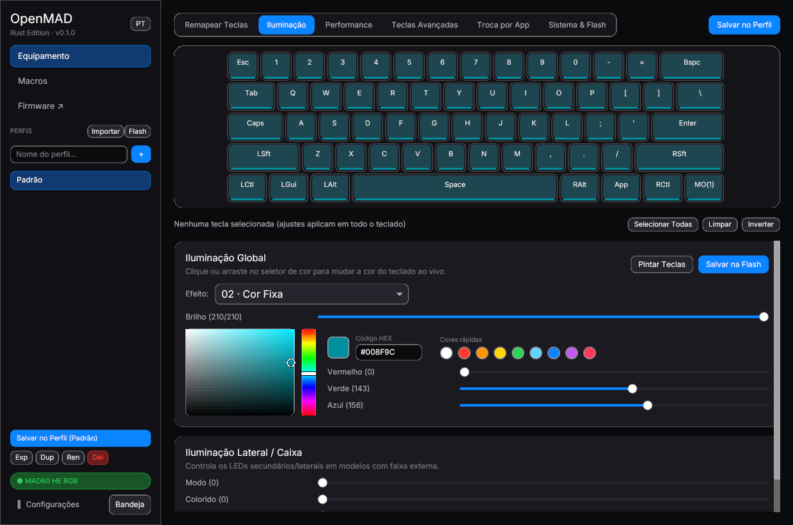
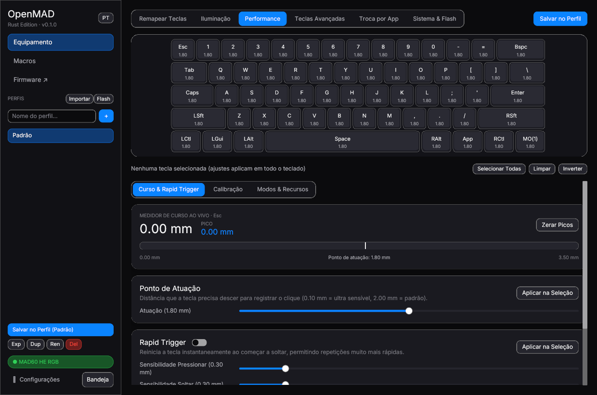
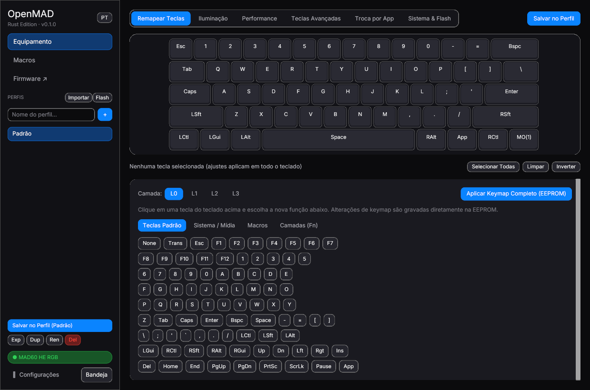
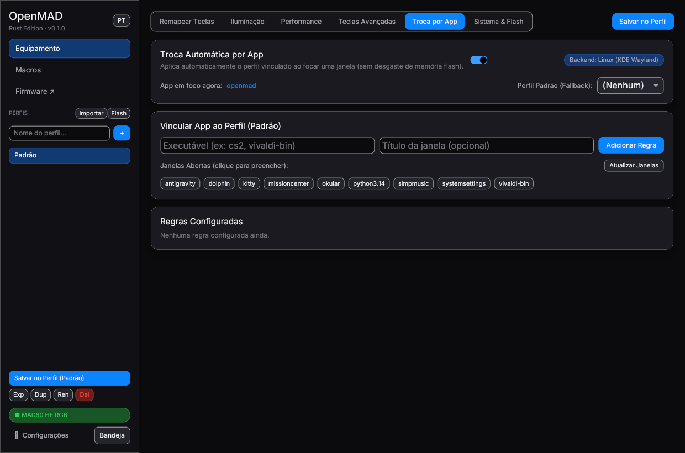
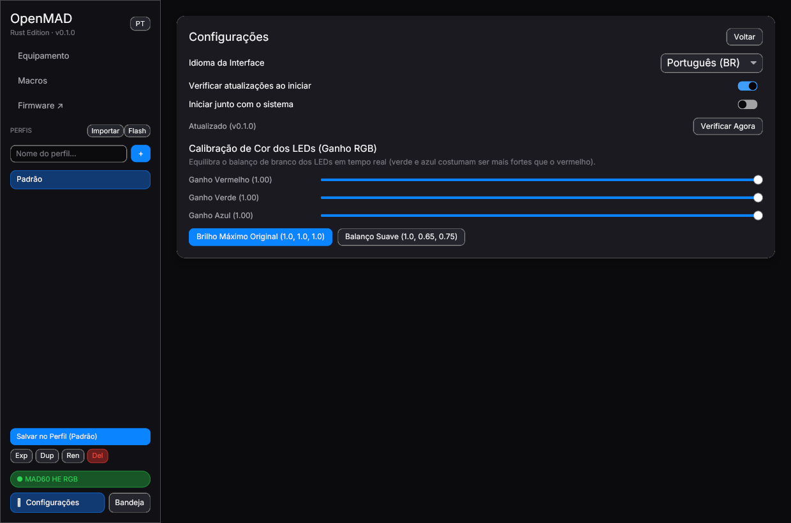

<div align="center">


# OpenMAD-Rust

**Driver nativo, utilitário de telemetria e configurador em tempo real 100% em Rust para teclados magnéticos Hall-Effect MAD68 HE / MAD60 HE.**

[-0A84FF?style=for-the-badge)](README.md)
[](README.en.md)

[](LICENSE)
[](Cargo.toml)
[](https://github.com/muriloscolari/OpenMAD-Rust/releases)

</div>

---

O **OpenMAD-Rust** substitui completamente o configurador web oficial da Madlions e o protótipo original em Python/Web por uma aplicação **100% nativa em Rust** (`openmad-core` + `openmad-ui` com `iced`). O resultado é inicialização instantânea, consumo mínimo de memória, zero dependências de Electron/Chromium ou runtime Python e suporte nativo para **Linux (KDE Plasma Wayland, X11)** e **Windows**.

> [!NOTE]
> Este projeto é um fork e reescrita completa em Rust inspirada na engenharia reversa de protocolo HID USB realizada pelo projeto original [acciaw/OpenMAD](https://github.com/acciaw/OpenMAD).

---

## Capturas de Tela

### Iluminação RGB em Tempo Real & Seletor 2D HSV


### Performance, Curso das Teclas (0.10–3.50 mm) & Rapid Trigger


### Remapeamento de Teclas & Camadas


### Troca Automática de Perfil por Aplicativo (KDE Wayland / Windows)


### Configurações, Calibração RGB, Autostart & Auto-Updater


---

## Como Funciona

O projeto é dividido em dois crates principais no workspace Cargo:

1. **`openmad-core` (Driver, Protocolo e Daemons)**
   - **Comunicação HID Bruta (`hidapi`)**: Conecta-se diretamente à interface VIA/vendor (`VID 0x373B`, `usage_page 0xFF60`) do teclado magnético sem exigir navegador WebHID.
   - **Pré-visualização em RAM vs. Gravação em Flash**: Alterações de brilho, cor, atuação e Rapid Trigger são enviadas em tempo real para o teclado sem desgaste prematuro da memória flash interna (`FlashOp::Normal`). A gravação permanente ocorre apenas quando você salva explicitamente na memória interna (*Onboard Flash*).
   - **Amostrador de Telemetria (`sampler.rs`)**: Lê continuamente a posição analógica dos sensores Hall (calibrados até **3.50 mm**) e envia pacotes de telemetria ao vivo para o medidor de curso da interface gráfica.
   - **App Switcher Multiplataforma (`switcher.rs`)**:
     - **Linux / KDE Plasma Wayland**: Carrega automaticamente uma ponte leve via D-Bus no **KWin Scripting** (`openmad_kwin_bridge`), detectando a janela em foco em tempo real no Wayland sem precisar desativar segurança ou usar XWayland forçado.
     - **Windows**: Monitora o processo/título da janela em primeiro plano via API Win32 (`GetForegroundWindow`).
   - **Auto-Updater (`updater.rs`)**: Consulta as releases oficiais de `muriloscolari/OpenMAD-Rust` no GitHub, baixa o instalador ou binário da nova versão e aplica a atualização automaticamente.
   - **Autostart & Bandeja (`settings.rs`)**: Registra inicialização automática com argumento `--minimized` (via `~/.config/autostart/openmad.desktop` no Linux ou `HKCU\...\Run` no Windows).

2. **`openmad-ui` (Interface Gráfica & Bandeja do Sistema)**
   - Construída em **`iced 0.13` (`iced::daemon`)** com aceleração GPU e fonte `Inter`.
   - **Idioma bilíngue dinâmico (`PT` / `EN`)** alternável com um clique no cabeçalho lateral.
   - **Seletor de Cores 2D (HSV + Paleta Rápida)** que atualiza o teclado instantaneamente ao clicar ou arrastar.
   - **Ícone de Bandeja Nativo (`tray-icon`)**: Fechar a janela pelo `X` ou iniciar com `--minimized` mantém o aplicativo rodando discretamente na bandeja do sistema, com menu de clique direito para abrir a janela, alternar perfis salvos instantaneamente ou sair.

---

## Teclados Compatíveis

| Modelo | Vendor ID | Product ID | Status |
| :--- | :---: | :---: | :--- |
| **MAD60 HE RGB** | `0x373B` | `0x1054` | Testado em hardware real (driver, RGB, atuação, RT e KWin Wayland) |
| **MAD68 HE RGB** | `0x373B` | `0x1058` | Suportado via tabela de protocolo upstream |
| **MAD60 HE** | `0x373B` | `0x1053` | Suportado via tabela de protocolo upstream |

> [!IMPORTANT]
> **Aviso de Segurança de Firmware / Keymaps**: O firmware do teclado organiza remapeamentos de teclas em slots gravados na flash. Nunca desconecte o cabo USB enquanto estiver gravando na memória flash interna. O OpenMAD-Rust possui confirmação de segurança e opção de backup/leitura da flash para evitar perda de configuração.

---

## Tutorial de Instalação

Escolha o instalador ideal para o seu sistema operacional na página de **[GitHub Releases](https://github.com/muriloscolari/OpenMAD-Rust/releases)**:

### 1. Windows (Instalador `.exe`)

1. Acesse a página de [Releases](https://github.com/muriloscolari/OpenMAD-Rust/releases) e baixe o arquivo **`OpenMAD-Setup-<versao>.exe`**.
2. Execute o instalador (não exige privilégios de administrador).
3. Durante a instalação, marque a opção **"Start automatically minimized to system tray on sign-in"** se desejar que o OpenMAD-Rust inicie minimizado na bandeja junto com o Windows (essa opção também pode ser ativada/desativada a qualquer momento dentro de **Configurações** no app).
4. **Atualizações automáticas**: Quando houver uma nova versão disponível no GitHub, o aplicativo exibirá o botão **Instalar Atualização** na aba *Configurações*, baixando e executando o novo Setup em modo silencioso automaticamente.

---

### 2. Arch Linux / CachyOS / Manjaro

> [!TIP]
> O arquivo [`packaging/arch/PKGBUILD`](packaging/arch/PKGBUILD) já está preparado para submissão futura ao **AUR**.

#### Opção A — Pacote pronto (`.pkg.tar.zst`)
1. Baixe o arquivo **`openmad-rust-<versao>-1-x86_64.pkg.tar.zst`** na página de [Releases](https://github.com/muriloscolari/OpenMAD-Rust/releases).
2. Instale com o `pacman`:
   ```bash
   sudo pacman -U openmad-rust-*.pkg.tar.zst
   ```
3. Recarregue as regras `udev` para liberar acesso sem `root` ao dispositivo HID (ou reconecte o teclado):
   ```bash
   sudo udevadm control --reload-rules
   sudo udevadm trigger --subsystem-match=hidraw --subsystem-match=usb
   ```

#### Opção B — Gerar e instalar o pacote direto do repositório
```bash
git clone https://github.com/muriloscolari/OpenMAD-Rust.git
cd OpenMAD-Rust
./packaging/arch/install-arch.sh
sudo pacman -U dist/openmad-rust-*.pkg.tar.zst
sudo udevadm control --reload-rules && sudo udevadm trigger --subsystem-match=hidraw --subsystem-match=usb
```

---

### 3. Debian / Ubuntu / Linux Mint / Pop!_OS (`.deb`)

1. Baixe o pacote **`openmad_<versao>_amd64.deb`** na página de [Releases](https://github.com/muriloscolari/OpenMAD-Rust/releases).
2. Instale com o `apt` (isso resolve automaticamente `libhidapi-hidraw0`, `libgtk-3-0`, `libayatana-appindicator3-1`, `libdbus-1-3` e aplica as regras `udev` via script `postinst`):
   ```bash
   sudo apt update
   sudo apt install ./openmad_*_amd64.deb
   ```
3. Caso o teclado já estivesse plugado antes da instalação e não seja detectado de imediato, desconecte e conecte o cabo USB ou execute:
   ```bash
   sudo udevadm control --reload-rules && sudo udevadm trigger --subsystem-match=hidraw --subsystem-match=usb
   ```

---

### 4. Binário Portátil Linux (com Auto-Atualização em Usuário)

Se você preferir que o botão interno **Instalar Atualização** consiga substituir o binário sem precisar de `sudo`:

1. Baixe `openmad-linux-x86_64` na página de [Releases](https://github.com/muriloscolari/OpenMAD-Rust/releases).
2. Instale em `~/.local/bin/openmad`:
   ```bash
   install -Dm755 openmad-linux-x86_64 ~/.local/bin/openmad
   ```
3. Garanta que a regra [`packaging/linux/60-openmad.rules`](packaging/linux/60-openmad.rules) esteja em `/etc/udev/rules.d/60-openmad.rules`:
   ```bash
   sudo cp packaging/linux/60-openmad.rules /etc/udev/rules.d/
   sudo udevadm control --reload-rules && sudo udevadm trigger --subsystem-match=hidraw --subsystem-match=usb
   ```
4. Execute `~/.local/bin/openmad` uma vez: o aplicativo registrará automaticamente o atalho no menu de aplicativos e o ícone PNG em `~/.local/share/`.

---

## Inicialização Automática na Bandeja (`Autostart`)

Você pode ativar ou desativar a inicialização automática diretamente em **Configurações -> Iniciar minimizado na bandeja com o sistema** — ou passar `--minimized` / `--tray` na linha de comando:

```bash
openmad --minimized
```

- **Linux**: cria/remove `~/.config/autostart/openmad.desktop` apontando para o executável atual com `--minimized`.
- **Windows**: adiciona/remove a entrada `"<caminho>\OpenMAD.exe" --minimized` em `HKCU\Software\Microsoft\Windows\CurrentVersion\Run`.

---

## Compilando do Código-Fonte

Pré-requisitos no Linux (Arch/Debian):
- Rust & Cargo (`rustup` / `cargo`)
- Bibliotecas de desenvolvimento: `hidapi`, `gtk3`, `libayatana-appindicator` (e `libudev` / `dbus` / `vulkan` ou OpenGL para `iced`)

```bash
git clone https://github.com/muriloscolari/OpenMAD-Rust.git
cd OpenMAD-Rust
cargo test --workspace
cargo build --release --bin openmad
./target/release/openmad
```

---

## Repositórios & Licença

- **GitHub**: https://github.com/muriloscolari/OpenMAD-Rust
- **Forgejo**: https://git.muriloscolari.me/murilo/OpenMAD-Rust
- **Projeto Original / Créditos**: [acciaw/OpenMAD](https://github.com/acciaw/OpenMAD)
- **Licença**: [GPL-3.0-or-later](LICENSE)
